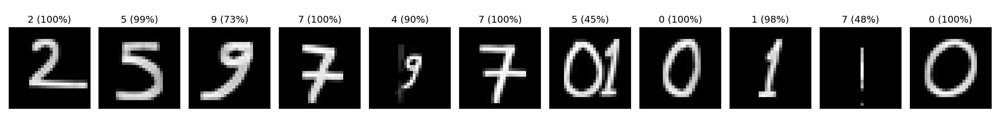

# mnist-mlp
# MNIST ile MLP Tabanlı El Yazısı Rakam Tanıma

**Ad Soyad:** Emrullah Yeşilkaya  **Öğrenci No:** 25979701010

## 1. Çalıştırma
`Yapay_Sinir_Ağları_HW1.ipynb` dosyası Google Colab'da (T4 GPU) baştan sona çalıştırılabilir. Hazır eğitilmiş model kullanılmamıştır, CNN kullanılmamıştır; model sıfırdan eğitilmiştir

## 2. Veri ayrımı
| Küme | Adet | Kullanım |
|---|---|---|
| Train | 50.000 | Ağırlıkları öğrenme |
| Validation | 10.000 | Epoch takibi, en iyi modeli seçme |
| Test | 10.000 | Yalnızca en sonda bir kez |

Train/validation, MNIST'in 60.000'lik eğitim kümesinden seed=42 ile ayrıldı. Test kümesi MNIST'in resmi test kümesidir ve model geliştirme sürecinde kullanılmadı. Normalizasyon: (x − 0.1307) / 0.3081.

## 3. Deney 1 – Temel MLP
Mimari: 784 → 256 (ReLU) → 128 (ReLU) → 10. Toplam 235.146 parametre.

| Hiperparametre | Değer |
|---|---|
| Hidden layer | 2 (256, 128) |
| Aktivasyon | ReLU |
| Loss | CrossEntropyLoss |
| Optimizer | Adam |
| Learning rate | 0.001 |
| Batch size | 128 |
| Epoch | 20 |
| Dropout | 0 |
| Seed | 42 |
| Model seçimi | En düşük validation loss (epoch 7) |

### Sonuçlar
| Metrik | Değer |
|---|---|
| Training loss (epoch 20) | 0.0101 |
| Validation loss (epoch 20) | 0.1167 |
| Training accuracy (epoch 20) | %99.67 |
| Validation accuracy (epoch 20) | %97.73 |
| Test loss (en iyi model) | 0.0875 |
| Test accuracy (en iyi model) | %97.74 |
| Eğitim süresi | 239.9 sn |

### Yorum
Train loss 0.30'dan 0.01'e düzenli düştü, ancak validation loss epoch 7'de en düşük değerine (0.0855) ulaşıp sonra dalgalanarak yükseldi. Train accuracy (%99.7) ile validation accuracy (%97.7) arasındaki fark, modelin eğitim verisini ezberlemeye başladığını (overfitting) gösteriyor. Validation loss kötüleşirken validation accuracy yaklaşık %97.5'te kaldı: loss modelin kararlılığını da ölçtüğü için, yanlış tahminlerde aşırı özgüven loss'u artırabilir. Test sonuçları validation'a çok yakın olduğundan model seçimi test verisine iyi genelleniyor.

## 4. Kendi el yazım

**Deneme 1:** Beyaz kağıda kurşun kalemle yazıldı.

**Deneme 2:** Beyaz kağıda keçeli kalemle yazıldı, 9'lar daha oval yazıldı.

Ön işleme: gri tonlama → arka plan çıkarma (aydınlatma düzeltme) → eşikleme → çizgi kalınlaştırma → rakamları ayırma → 20 px'e ölçekleme → 28×28 tuvale ağırlık merkezine göre yerleştirme → MNIST ortalama/std ile normalizasyon. İki denemede de aynı ayarlar kullanıldı.

### Deneme 1 sonucu
| | |
|---|---|
| Beklenen | 25979701010 |
| Tahmin | 25373701010 |
| Doğru rakam | 9/11 (%81.8) |

3. ve 5. rakamlar (9) hatalı tahmin edildi (3. rakam: 3 → %79.8, 9 ilk üçte yok; 5. rakam: 3 → %73.6, 9 → %25.4). Doğru tahminlerin güveni %97-100, hatalı olanların %74-80 idi.

### Deneme 2 sonucu
| | |
|---|---|
| Beklenen | 25979701010 |
| Tahmin | 25974750170 |
| Doğru rakam | 6/11 (%54.5) |

Oval yazdığım ilk 9 (3. rakam) doğru tanındı (%72.6), ikinci 9 (5. rakam) 4 olarak tahmin edildi (%90.1). 7.-10. rakamlarda beklenen `0 1 0 1` dizisi için `5 0 1 7` tahmin edildi (güvenler: %44.7, %100, %98.2, %48.0).

Deneme 2'deki 28×28 görsellere baktığımda 5. rakamın (9) solunda fotoğraftaki dikey bir çizginin (kağıt kıvrımı/kenarı) ön işlemede mürekkep olarak algılanıp kırpmaya dahil edildiğini gördüm. Bu yüzden 9 küçülmüş ve model onu 4 olarak tahmin etti (%90.1; 9'a %6.8). Bu hata, modelin 9'u tanıyamamasından çok ön işleme adımından kaynaklanıyor görünüyor. Oval yazdığım 3. rakam (9) ise MNIST 9'larına benzer biçimde kırpıldı ve doğru tanındı (%72.6), ancak 3'e de %27.4 olasılık verildi. 7.-10. rakamlardaki hataların nedenini ayrıca incelemedim.

### MNIST ile karşılaştırma (Deneme 1)

Deneme 1'de 9'ların 3'e benzetilmesini, 9'ların kuyruğunun köşeli yazılmasına bağlayan bir hipotezim vardı, ama bunu doğrulayacak bir test yapmadım. Deneme 2'de oval yazdığım 9 doğru tanındı, ancak 3'e de belirgin olasılık verdi. Bu, 9/3 karışıklığının yazı şekliyle ilişkili olabileceğine işaret ediyor, fakat kesin bir sonuç değil.

## 5. Genel değerlendirme
- MNIST test accuracy %97.74 iken kendi el yazımda Deneme 1'de %81.8 (9/11), Deneme 2'de %54.5 (6/11) doğru rakam elde ettim. Fark **distribution shift** ile uyumlu: eğitim verisi MNIST yazarlarının stiline ait, gerçek dünya verisi benim yazı stilimle, farklı kalem ve fotoğraf koşullarıyla geliyor.
- 11 rakamlık örneklemler küçük olduğu için bu oranlar genel başarı değil, birer gözlemdir.
- İki fotoğrafta kalem, çizgi kalınlığı, 9'ların şekli ve rakamlar arası boşluk aynı anda değiştiği için düşüşün nedenini tek bir etkene bağlayamam.
- Deneme 2'deki hataların en az biri (5. rakam), fotoğraftaki bir çizginin ön işlemede rakama dahil edilmesinden kaynaklanıyor görünüyor. Gerçek dünya verisinde başarı yalnızca modele değil, görüntü hazırlama adımına da bağlıdır.
- Hatalı tahminlerin güveni her zaman düşük değil: Deneme 2'de 8. ve 9. rakamlar yanlış olduğu halde %98-100 güvenle tahmin edildi.
- MLP görüntüyü 784 bağımsız piksel olarak gördüğü için çizgi kalınlığı ve piksel konumu gibi küçük değişikliklere duyarlı. Bu, CNN'e kıyasla bir sınırlılık, ama bu ödevde CNN kullanılmadı.

**NOT:** Repoyu Colab'da açmanız tavsiye edilir.
