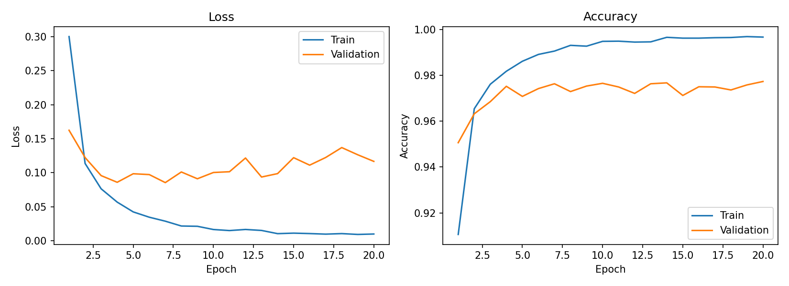
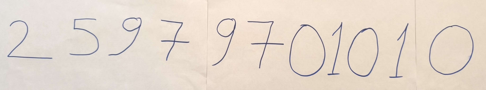
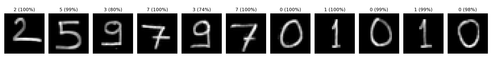
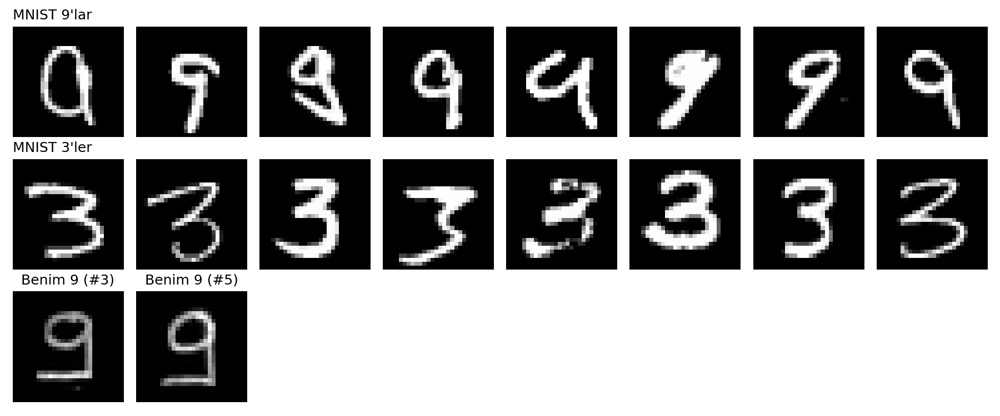

# mnist-mlp
# MNIST ile MLP Tabanlı El Yazısı Rakam Tanıma

**Ad Soyad:** Emrullah Yeşilkaya  **Öğrenci No:** 25979701010

## 1. Çalıştırma
`Yapay_Sinir_Ağları_HW1.ipynb` dosyası Google Colab'da (T4 GPU) baştan sona çalıştırılabilir.

## 2. Veri ayrımı
| Küme | Adet | Kullanım |
|---|---|---|
| Train | 50.000 | Ağırlıkları öğrenme |
| Validation | 10.000 | Epoch takibi, en iyi modeli seçme |
| Test | 10.000 | Yalnızca en sonda bir kez |

Train/validation, MNIST'in 60.000'lik eğitim kümesinden seed=42 ile ayrıldı. Test kümesi MNIST'in resmi test kümesidir ve model geliştirme sürecinde kullanılmadı. Normalizasyon: (x − 0.1307) / 0.3081.

## 3. Deney 1 – Temel MLP
Mimari: 784 → 256 (ReLU) → 128 (ReLU) → 10. Toplam 235.146 parametre.

| Hiperparametre | Değer |
|---|---|
| Hidden layer | 2 (256, 128) |
| Aktivasyon | ReLU |
| Loss | CrossEntropyLoss |
| Optimizer | Adam |
| Learning rate | 0.001 |
| Batch size | 128 |
| Epoch | 20 |
| Dropout | 0 |
| Seed | 42 |
| Model seçimi | En düşük validation loss (epoch 7) |

### Sonuçlar
| Metrik | Değer |
|---|---|
| Training loss (epoch 20) | 0.0101 |
| Validation loss (epoch 20) | 0.1167 |
| Training accuracy (epoch 20) | %99.67 |
| Validation accuracy (epoch 20) | %97.73 |
| Test loss (en iyi model) | 0.0875 |
| Test accuracy (en iyi model) | %97.74 |
| Eğitim süresi | 239.9 sn |

### Yorum
Train loss 0.30'dan 0.01'e düzenli düştü, ancak validation loss epoch 7'de en düşük değerine (0.0855) ulaşıp sonra dalgalanarak yükseldi. Train accuracy (%99.7) ile validation accuracy (%97.7) arasındaki fark, modelin eğitim verisini ezberlemeye başladığını (overfitting) gösteriyor. Validation loss kötüleşirken validation accuracy yaklaşık %97.5'te kaldı: loss modelin kararlılığını da ölçtüğü için, yanlış tahminlerde aşırı özgüven loss'u artırabilir. Test sonuçları validation'a çok yakın olduğundan model seçimi test verisine iyi genelleniyor.

## 4. Kendi el yazım
. Beyaz kağıda kurşun kalemle yazıldı.
. Beyaz kağıda keçeli kalemle yazıldı. 9'lar daha oval yazıldı.

Ön işleme: gri tonlama → arka plan çıkarma (aydınlatma düzeltme) → eşikleme → çizgi kalınlaştırma → rakamları ayırma → 20 px'e ölçekleme → 28×28 tuvale ağırlık merkezine göre yerleştirme → MNIST ortalama/std ile normalizasyon.

### Deneme 1
| | |
|---|---|
| Beklenen | 25979701010 |
| Tahmin | 25373701010 |
| Doğru rakam | 9/11 (%81.8) |

### Deneme 2 (keçeli kalem, daha oval 9'lar)
| | |
|---|---|
| Beklenen | 25979701010 |
| Tahmin | 25373701010 |
| Doğru rakam | 9/11 (%81.8) |

- Kendi el yazımda Deneme 1'de %81.8 (9/11), Deneme 2'de %54.5 (6/11) doğru rakam elde ettim. İki fotoğrafta kalem, çizgi kalınlığı, 9'ların şekli ve rakamlar arası boşluk aynı anda değiştiği için düşüşün nedenini tek bir etkene bağlananamaktadır.
- Deneme 2'de oval yazdığım ilk 9 doğru tanındı, ikincisi tanınmadı. 11 rakamlık örneklemle bu farkın yazı şeklinden mi, ayırma hatasından mı geldiğini söylenememektir.

### MNIST ile karşılaştırma

9'ların köşeli olması sebebiyle, 3 veya 5'e benzetildiği düşünülmektedir.

## 5. Genel değerlendirme
- MNIST test accuracy %97.74, kendi el yazımda %81.8 (9/11). Fark **distribution shift** ile uyumlu: eğitim verisi MNIST yazarlarının stiline ait, gerçek dünya verisi benim yazı stilimle, farklı kalem ve fotoğraf koşullarıyla geliyor.
- 11 örnek küçük bir örneklem olduğu için %81.8 genel bir başarı oranı değil, bir gözlemdir.
- Her iki denemede de aynı iki rakam (9) hatalı çıktı, bu yüzden hata tesadüf değil, sistematik görünüyor.
- MLP görüntüyü 784 bağımsız piksel olarak gördüğü için çizgi kalınlığı ve piksel konumu gibi küçük değişikliklere duyarlı. Bu, CNN'e kıyasla bir sınırlılık, ama bu ödevde CNN kullanılmadı.
  
NOT: Repoyu colabde açmanız tavsiye edilir!
